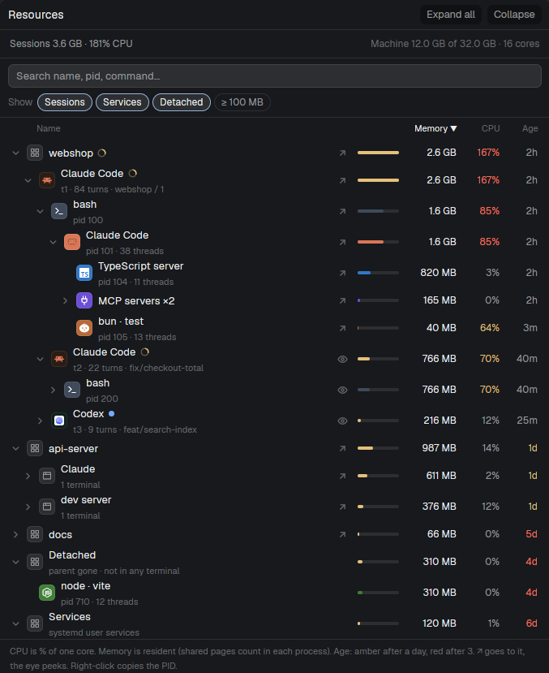

# Resources for Herdr

Memory and CPU for every Herdr session, as a tree you can drill into: space › tab › terminal › every process. Agents sit under the terminal that started them. Forgotten dev servers and stuck workers show up in their own Detached group. You can search, sort by any column, filter, and jump to a pane from any row.

**Add it:** ask your agent to add `herdr.dev/mods/sling86/herdr-resources`, or copy `mods/resources/` into `~/.config/herdr-app/mods/`. Open it with `herdr-app do mod.open --name resources`, or put it in a layout block.

**Needs** Linux (it reads `/proc`). It shows local terminals only. Every 3 seconds while it's on screen, it runs `ps` and reads `/proc`, and it calls `hc get` once per terminal. It never uses the network and never kills anything.

How it's built, and how to rebuild it from scratch: [RECIPE.md](RECIPE.md).
