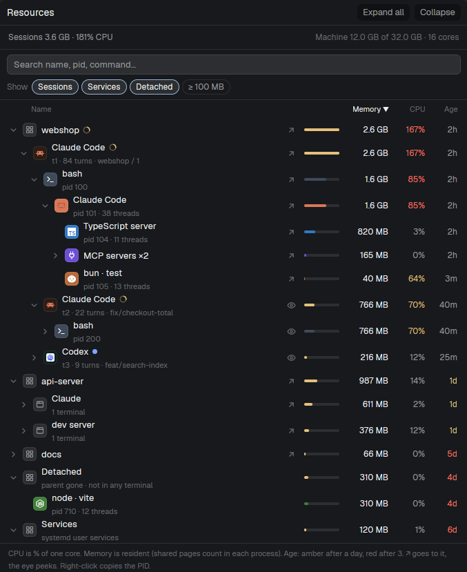

# Resources

A window (or side-panel block) that shows how much memory and CPU each Herdr session is using, as a tree you can open right down to single processes: space › tab › terminal › every process under it. The agents a terminal started sit under it, the way Herdr's agent list shows them. Processes that lost their terminal show in their own groups, so forgotten dev servers and stuck workers are easy to spot. Search, sort by any column, filter, and jump to a pane from any row.

## What you see

Top to bottom, on the theme's `surface`:

- **Title bar**, 34px, bottom border `border`: "Resources" (13px, semibold) on the left; **Expand all** and **Collapse** buttons (22px high, 6px radius, `chrome` fill, `muted` text, `hover` on hover) on the right.
- **Totals line**, 11px: left, `Sessions <memory> · <cpu>% CPU` in `muted` (sessions only, not Services or Detached); right, `Machine <used> of <total> · <n> cores` in `dim`.
- **Search box**, 26px, 6px radius, `raised` fill, `border` outline (`accent` while it holds text): placeholder "Search name, pid, command…". A **Clear** button appears beside it while it has text.
- **Show chips** (20px pills, 10px radius, 11px text; on = `selected` fill with an `accent` outline): **Sessions**, **Services**, **Detached**, **≥ 100 MB**.
- **Column headings**, 10px `dim`: Name on the left; Memory, CPU and Age right-aligned over their columns. The active sort heading is `foreground` with ▼ or ▲.
- **The tree**, scrolling. Rows are 34px when they have a second line, 26px when not, 5px radius, `hover` on hover, indented 14px per level. Each row, left to right:
  - a 12px chevron (Herdr's `mods/files/chevron-right.svg` / `chevron-down.svg`), empty on a leaf;
  - an 18px tile (5px radius, faint white border) with an 11px glyph;
  - the name (12px `foreground`, semibold for spaces and terminals), a status dot or spinner for non-idle spaces and terminals, and under it a 10px `dim` detail line;
  - a 20px jump button: ↗ (`mods/resources/go.svg`) or an eye (`mods/resources/peek.svg`), `dim`, turning `foreground` on a `selected` fill on hover;
  - a 46×4px memory bar: the row's share of the biggest top-level group, in the process colour (or `working`), on `raised`, animating its width over 300ms;
  - Memory (58px, 11px, `foreground`): `612 MB`, `2.1 GB`;
  - CPU (42px): `% of one core`; `blocked` at 80% or more, `working` at 20% or more, else `muted`;
  - Age (36px): `9m`, `5h`, `3d`; `blocked` at 3 days or more, `working` at 1 day or more, else `muted`.
- **Footer**, 10px `dim`, top border: what CPU and memory mean, the age colours, what ↗ and the eye do, and that right-click copies the PID.

**Levels and tiles:**

- **Space** (grid glyph, `mods/resources/space.svg`, on `raised`): the Herdr space's name.
- **Tab** (`mods/resources/tab.svg`): the tab's name. Skipped when a space has one tab. Terminals with no tab label go under "Hidden terminals".
- **Terminal:** the program tile from Herdr's own table (`program.tile`, `program.icon`, tinted when `program.tint`), exactly as the terminals bar draws it. Detail line: `t47z · 84 turns · <branch or where>`.
- **Process:** a tile in the process's colour with a white glyph from Herdr's `icons/<name>.svg` (drawn as a picture instead when that icon is full colour); `icons/program.svg` when there's no icon. Detail line: `pid 101 · 38 threads`, plus the unit name for a service. Brand colours: Claude `#d97757`, Codex `#10a37f`, Node `#417e38`, Bun `#b8693a`, Python `#3776ab`, TypeScript server `#3178c6`, Git `#f05032`, Docker `#2496ed`, Postgres `#336791`, shell `#3f4a5a`, MCP `#6d4fd6` (`mods/resources/mcp.svg`); anything else gets a stable colour from a hash of its name.
- **Group:** two or more siblings of the same type fold into one row, for example "MCP servers ×4", "TypeScript server ×2" or "node ×3", with their totals. It opens into the single processes.
- **Services** (`systemd user services`) and **Detached** (`parent gone · not in any terminal`) are the last two groups.

## How it behaves

- **Statuses:** a space or terminal that's `working` shows Herdr's spinner (`mods/workspace-chrome/spinner.svg`, 10px, `working`, spinning every 900ms); `blocked` and `done` show a 6px dot in that status colour; `idle` shows nothing.
- **Totals add up at every level.** A terminal includes its processes and its workers (terminals whose hc `parent` is this terminal), nested under it however deep. A worker whose parent has gone stays at the top level.
- **Click** a row to open or close it. **Expand all** opens everything. **Collapse** closes everything. On first load the spaces start open.
- **Jump (↗ / eye):**
  - space: `space.select {id}`;
  - tab: `space.select`, then `tab.select {id}`;
  - terminal with a pane: `pane.focus {terminal}`; with no pane, the eye: `terminal.peek {terminal}`;
  - process: the same, for the terminal that owns it;
  - Services and Detached rows have no button.

  **Double-clicking** a terminal row does the same as its button.
- **Right-click** copies the PID, or `hc read <address>` on a terminal.
- **Hover** a process to see its full command line in a tooltip.
- **Search:** every word must appear in the row's name, details, address, PID or command line. A matching row keeps everything under it. The path to each match opens by itself, and clearing the search restores what was open.
- **Sort:** click a heading. Memory, CPU and Age sort biggest or oldest first, Name A to Z. Click the active heading again to flip it. Every level of the tree is sorted. Services and Detached stay last.
- **Show chips** turn the three groups on or off. **≥ 100 MB** hides smaller terminals and processes.
- Sort, direction and chips are remembered in `localStorage`. Search starts empty.
- **Refresh:** every 3 seconds, and only while the mod can be seen: a pane on the focused tab, an open overlay, or a layout block with no hidden parent whose stacks show it.

## Built from

- `mod.json`: `{ "place": "none", "title": "Resources", "overlay": { "kind": "window", "key": "resources", "width": 560, "height": 640 } }`. Open it with `mod.open {name: "resources"}`, or put `{ "type": "block", "content": { "mod": "resources" } }` in a layout (for example in a side-panel stack).
- `res.js` holds everything testable, with no Herdr or GPUI in it: sample parsing, kinds and colours, grouping, the tree, detached and service detection, sort, filter and jump targets.
- `main.js` is the view: `View`, `div`, `svg` and `image` from `gpui-kit`; `v_flex`, `h_flex`, `InputState` and `Input` from `gpui-base`.
- **`herdr` functions:**
  - data: `terminals()`, `spaces()`, `panes()`, `props()`, `layout()`, `focused()`, `theme()`;
  - running things: `exec()`, `hc()`, `run()`, `appHome()`.
- **Programs it runs:**
  - **Every 3 s while shown, one local `sh -c`** that prints:
    - `cat /proc/[0-9]*/stat` (ticks, threads, start time, RSS);
    - `grep -H '' /proc/[0-9]*/cgroup` (systemd unit);
    - `ps -eo pid=,uid=,args=` (command lines);
    - MemTotal and MemAvailable;
    - `nproc`, `getconf CLK_TCK`, `getconf PAGESIZE`, `id -u`, and `/proc/uptime`.

    Sections are split on markers that sit on a line of their own (`<<cg>>`, `<<ps>>`, `<<sys>>`).
  - **`hc get <address> --json` once per terminal** to learn its PID, when `terminals()` doesn't carry one. The result is cached, and dropped when the PID disappears.
  - **Once at start:** `ls` and `grep` in `icons/`, to learn which icons exist and which are full colour.
- **Live CPU** comes from the tick difference between two samples divided by the time between them, so it's "% of one core right now", not a lifetime average.
- **Detached and Services:** processes of the current user, adopted by pid 1 or a `systemd` manager, whose kind is dev tooling (node, bun, deno, npm, pnpm, python, uv, claude, codex, tsc, go, cargo, java, or anything that looks like an MCP server). Those whose cgroup unit is a `.service` other than `hc-hold-*` or `user@N.service` are Services; the rest are Detached.
- **Never reaches the network. Never kills anything.** It only reads files under its own folder and Herdr's `icons/`, plus `/proc`.

## Watch out

- **Linux only** (`/proc`, cgroup v2). Elsewhere the sample fails and the tree shows "Couldn't read processes".
- **Local terminals only.** Terminals on other machines (`machine/t7`) are skipped.
- **Memory is RSS.** Shared pages count in each process, so totals run high.
- **A process that leaves its terminal's tree** (double-forks, or is started with `setsid`) isn't counted under it. It shows in Detached if it's dev tooling.
- **Under QuickJS, building the tree is the slow part.** Build it once per sample and filter and sort only when the settings change, never on every redraw (`terminals()` redraws often). Append to lists with `push`: rebuilding a list with `[...list, x]` for every child is quadratic, and a parent like systemd has hundreds of children. A render that runs too long shows Herdr's "could not be re-rendered … interrupted" banner.
- **Hot reload:** if `main.js` lands before a changed `res.js`, the reload pairs new code with old exports. Copy `res.js` first.
- **The first sample shows 0% CPU everywhere**, because it needs two samples for a difference.
- **Thread-named processes** (`node-MainThread`) and `npm exec` wrappers report odd `comm` names. Classify by the command line too: package name from `node_modules/<pkg>`, skipping `.bin`; script basename otherwise.
- **In `/proc/<pid>/stat`, `comm` can contain spaces and brackets.** Split around the last `)`.

## Done when

- `herdr-app check mods/resources` passes.
- `mod.open {name: "resources"}` opens a window listing your spaces, each with the right total, and the numbers change every 3 seconds.
- Opening a Claude terminal shows its shell, then Claude, then its MCP servers folded into "MCP servers ×N", then each server.
- A terminal started by another (hc `parent`) appears under it, not as its own space.
- Typing a PID or `vite` in search shows only the matching rows with their paths open. Clear brings the old view back.
- Clicking Memory, CPU, Age and Name reorders every level. Clicking the active heading again flips it.
- ↗ on a terminal focuses its pane. The eye on a hidden terminal peeks at it.
- Starting `nohup bun -e 'setInterval(()=>{},1e3)' &` from a terminal, then closing that terminal, shows the bun process under Detached with its age.
- With the mod in a hidden side panel, no `ps` runs (watch `pgrep -f 'getconf PAGESIZ[E]'`).
